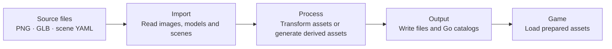

# Asset pipeline

Keep your source artwork in the project and describe how to prepare it in
`asset.config.go`. Ashura runs that Go recipe before compiling the game. The game
uses the prepared files, so it doesn't need PNG decoders, model importers or
texture encoders.

[Write your first recipe](getting-started.md), or browse the plugins by their main
job:

| Category | What you'll find |
| --- | --- |
| [Importers](importers/README.md) | Read images, GLB models, scenes and prefabs. |
| [Processors](processors/README.md) | Resize images, pack atlases, optimize meshes and prepare UVs. |
| [Generators](generators/README.md) | Create surface maps, reflection captures, lightmaps, impostors and font atlases. |
| [Publishers](publishers/README.md) | Write textures, Go catalogs and external model or level files. |

These categories describe a plugin's job. Recipes still have three ordered lists:
`Import`, `Process` and `Output`. Processors and generators can alternate within
those lists. Some plugins combine jobs: `GLBWithOptions` imports and publishes a model,
for example. Each guide shows where to put the plugin and what else it needs.

## What are you making?

| I need… | Start here |
| --- | --- |
| Textures for a material | [Image importer](importers/image-import.md), then [texture output](publishers/image-ktx2.md) |
| Icons or panel artwork | [UI images](publishers/ui-images.md) |
| Sprites | [2D images](publishers/sprite-images.md) |
| A GLB model to embed or use in a level/impostor recipe | [Import GLB models](importers/model-glb.md) |
| A level with models, lights, logic and prefabs | [Level scene import](importers/scene-lightmap-baking.md) |
| A cheaper substitute for a distant model | [Impostor cards](generators/model-impostors.md) |
| A reflection capture from a primitive room | [Reflection generator](generators/scene-reflections.md) |
| An authored panorama to use for reflections | [Reflection probes](processors/image-reflection-probes.md) |

The plugins use [xatlas, meshoptimizer, Basis Universal and msdfgen](tools.md)
through Go-hosted WebAssembly libraries. Materialize and GPU lightmap baking have
additional host requirements, explained in the same guide.
