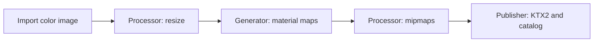

# Generators

[Asset pipeline](../README.md) · [Get started](../getting-started.md)

Generators create another kind of asset from their inputs: a model becomes an
impostor, a scene becomes lighting textures, or a color image becomes surface
maps. [Processors](../processors/README.md) prepare an asset for the same use,
by resizing it, packing it or changing its layout.

## Choose a generator

| I have… | I need… | Generator |
| --- | --- | --- |
| A color photograph or texture | Normal and ambient-occlusion maps | [Materialize](image-materialize.md) |
| A normal map or height image | Self-shadowed surface response for RNM lighting | [SSBump maps](image-ssbump.md) |
| A room made of planes, boxes and spheres | A reflection panorama and typed room data | [Reflection capture](scene-reflections.md) |
| A prepared static scene | Baked lighting textures | [Lightmap bake](level-lightmap-bake.md) |
| A detailed static model | A lightweight captured proxy | [Model impostors](model-impostors.md) |
| The bundled Go Regular font | Its distance-field atlas and glyph metrics | [Default font](font-default.md) |

For an existing panorama, use the
[reflection probes](../processors/image-reflection-probes.md).
It converts the reflection image you already have into the GPU layout.

## Where do they go in a recipe?

Generators are a documentation category. Recipes still use `Import`, `Process`
and `Output`; follow the placement shown in each guide:

| Generator | Recipe list | What follows it |
| --- | --- | --- |
| `reflectionbuild.Scene` | `Import` | ReflectionProbes, then KTX2 and GoCatalog. |
| `assetbuild.Materialize`, `assetbuild.SSBump` | `Process` | Image processing and publication, or level material preparation. |
| `levelbuild.ProductionBake` | `Process` | A level publisher. |
| `impostorbuild.Cards` | `Process` | It publishes its own impostor files and Go accessors. |
| `uibuild.DefaultFont` | `Output` | It publishes the matching atlas and glyph files itself. |

Processors and generators can alternate. For example, resize a photograph,
generate its surface maps, then create smaller texture levels before encoding:

Quality settings affect build time and the size of the resulting assets. The
finished game uses prepared data. [Materialize](image-materialize.md) and
[lightmap baking](level-lightmap-bake.md) need a GPU on the build machine; the
other generators listed here do not need a GPU capture device. See
[tools and libraries](../tools.md) for their dependencies.
