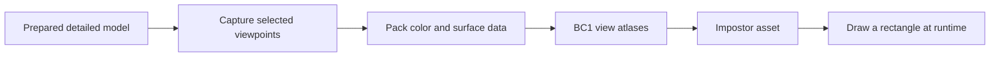

# Bake model impostors

[Asset pipeline](../README.md) · [Generators](README.md)

Use `impostorbuild.Cards(...)` to replace a detailed static model with a flat
rectangle at a distance. The build captures the model from multiple directions
and stores those pictures in textures. At runtime, the impostor chooses and
blends captured views as the camera moves. This reduces geometry work, with a
visible loss of detail when viewed close up.

Each captured view stores color, silhouette, surface direction and depth.
Octahedral mode distributes views around the full sphere; Angular
mode uses explicit horizontal and vertical angles. Both use BC1-compressed
atlases. Layered mode instead stores occupied depth ranges in exact RGBA8 data
and needs a closed solid model. The plugin writes its own `.kimp` files and Go
accessors, so a separate publisher is unnecessary.



The diagram shows the Octahedral/Angular path. `Resolution` is the size of
**each captured view**, while the complete atlas contains every view plus its
padding. A 7×7 grid contains 49 views, so it is much larger than one 256px image.

Import `impostorbuild "github.com/karty-game/karty-webgpu/pkg/impostor/build"`.

## Settings and defaults

`Cards` requires an `impostorbuild.Options` argument. The library's zero-value
defaults differ from the current sample's explicit 256px, 7×7 settings.

| Setting | Zero/default | Meaning |
| --- | --- | --- |
| `Mode` | `Octahedral` | `Octahedral`, `Angular` or `Layered`. With empty mode, any nonzero angular angle/count field selects Angular. Prefer an explicit mode. |
| `Include` | All prepared models | Asset-identity patterns, including the source `.glb` extension. |
| `Resolution` | Octahedral: 80; Angular/Layered: 128 | Pixels per captured view, excluding padding. View modes accept 16–512; Angular requires a power of two. Layered requires a power of two from 32–256. |
| `FrameGrid` | Octahedral: 8 | Octahedral grid side, 4–8: 8 means 64 captures; 7 means 49. Leave zero for other modes. |
| `Azimuths` | Angular: 8 | Angular horizontal views, at least 2. |
| `Elevations` | Angular: 3 | Angular vertical views, at least 2. Product with `Azimuths` must be at most 64. |
| `ElevationMin`, `ElevationMax` | Angular: -30°, +30° when both zero | Angular range within -80°…80°, minimum strictly below maximum. Leave both zero outside Angular. |
| `Padding` | 4 | Texels around each capture, 1–128. Zero selects the default, not no padding. |
| `MipLevels` | View modes: 3; Layered: 1 | Offline mip levels, 1–8 for views. Layered requires exactly one numeric level. |
| `MaxIntervals` | Layered: 8 | Occupied depth intervals per axis pixel, 1–16. Leave zero for view modes. |

For view modes, `Padding` must be at least `2^(MipLevels-1)`;
`Resolution` and `Resolution + 2*Padding` must be divisible by that value.
Base atlas dimensions must be multiples of four for BC1 and at most 4096 per
axis. The view atlas width and height are the padded cell size times the grid
columns and rows. Layered mode requires closed solid input and validates its
own bounded occupancy layout.

## How to use it

This matches the current sample's default quality:

```go
{
    Name: "impostors", Input: []string{"assets/rock.glb"},
    Import: []assetbuild.Plugin{modelbuild.GLBWithOptions(modelbuild.GLBOptions{
        MaxTextureDimension: 256,
    })},
    Process: []assetbuild.Plugin{impostorbuild.Cards(impostorbuild.Options{
        Mode: impostorbuild.Octahedral, Resolution: 256, FrameGrid: 7,
        Padding: 8, MipLevels: 3,
    })},
},
```

Add the imports from [GLBWithOptions](../importers/model-glb.md) and use the
[recipe wrapper](../getting-started.md#prepare-some-textures). `GLBWithOptions` prepares the source model
first; `Cards` consumes it and leaves the original model available too. No
`KTX2` or `GoCatalog` is needed. Both stages publish their own output. If only
the proxy is needed, [PreparedGLB](../importers/model-prepared-glb.md) can import the model without
publishing the original model catalog.

Place `Cards` directly after its importer. It currently selects resources during
planning, so deferred mesh-processing replacements are not captured by putting
`Cards` after `Cleanup` or `Optimize`.

The proxy lives under `impostors/` in `Config.Output`, with a generated accessor
returning `impostor.Asset`. The runtime needs the impostor engine feature and BC
texture support for view atlases. Capture count and resolution are baked into
the asset; runtime quality controls cannot add missing detail.

See the [sample recipe](../../../samples/impostors/asset.config.go) and
[impostor runtime guide](../../../pkg/impostor/README.md).
