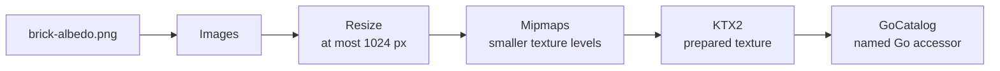

# Prepare assets

[Asset pipeline](README.md)

## Prepare some textures

Put `brick-albedo.png` in your game's `assets/` directory. From the Ashura
repository root, run this command with your game's directory.

```sh
mise exec -- go run ./cmd/engine assets generate --project /path/to/game
```

For a project without an `asset.config.go`, Ashura imports PNG and JPEG files,
generates mipmaps, and writes prepared RGBA8 textures and named Go accessors.

```text
generated/assets/
├── assets.go
└── brick-albedo.ktx2
```

Import your game's `generated/assets` package and call `assets.BrickAlbedo()`
for the prepared texture asset. Keep the source artwork in Git and ignore
`generated/`. Browser builds and previews prepare assets automatically.

## Check what the recipe will pick up

Run this from the Ashura repository root to see how a new file will appear in
your game's catalog before generating it.

```sh
mise exec -- go run ./cmd/engine assets inspect --project /path/to/game
```

For the default recipe, the image line shows
`assets/brick-albedo.png → generated/assets/brick-albedo.ktx2 → assets.BrickAlbedo()`.
UI and sprite recipes show the atlas, the call that loads the catalog, and the
field to use, such as `catalog.UiPlay`. The report flags patterns with zero
matches, paths skipped by PNG/JPEG import, and filenames that generate the same
Go name. For an atlas pattern, use extensionless image IDs such as `ui/play`.
The report shows the ID beside each imported file.

Inspection uses the same recipe planning as generation. It does not bake or
publish assets. Page counts, rectangles, and outputs discovered from baked
data require a build. Use `--phase build --profile release --target js/wasm`
to inspect a different recipe environment.

## Add a recipe

When you need to cap texture dimensions, add a build-only `asset.config.go`
beside your game's `go.mod`. This recipe keeps the same output directory and
names and caps textures at 1024 pixels before generating mipmaps.

```go
//go:build ignore

package main

import "github.com/karty-game/ashura/pkg/assetbuild"

func main() {
    assetbuild.Run(assetbuild.Config{
        Output: "generated/assets",
        Pipelines: []assetbuild.Pipeline{{
            Name: "textures", Input: []string{"assets/**"},
            Import: []assetbuild.Plugin{assetbuild.Images()},
            Process: []assetbuild.Plugin{
                assetbuild.Resize(assetbuild.ResizeOptions{MaxDimension: 1024}),
                assetbuild.Mipmaps(),
            },
            Output: []assetbuild.Plugin{assetbuild.KTX2(), assetbuild.GoCatalog()},
        }},
    })
}
```

The build tag keeps the recipe out of your game. It still runs on the host with
Go, including when the game targets the browser. Ashura's Go import path is
currently `github.com/karty-game/ashura`.



`Resize` preserves aspect ratio and won't enlarge a smaller image. `Mipmaps`
creates smaller versions for rendering at a distance. `KTX2()` writes an RGBA8
texture by default; choose its [BC1 or BC7 options](publishers/image-ktx2.md) when you
want compression. `GoCatalog` embeds the texture and gives it a Go name.

Run the same `assets generate` command after editing the recipe or its inputs.
`assets build --project /path/to/game --profile release` selects release when
a recipe defines special release settings. Both commands reuse verified cached
work. For more examples, see the [UI atlas](publishers/ui-images.md) and
[portable sprite catalog](publishers/sprite-images.md).

## Add another pipeline

Pipelines have their own inputs and intermediate assets. Keep dependent steps in
the same pipeline. Use another pipeline when you need a different result, such
as UI artwork alongside material textures.

`Name` identifies a pipeline; it doesn't create a directory. Set `Directory`
when two exporters would otherwise write the same filename:

```go
Output: "generated",
Pipelines: []assetbuild.Pipeline{
    {
        Name: "ui", Directory: "ui", Input: []string{"assets/ui/**"},
        Import: []assetbuild.Plugin{assetbuild.Images()},
        Output: []assetbuild.Plugin{uibuild.Images()},
    },
    {
        Name: "sprites", Directory: "sprites", Input: []string{"assets/sprites/**"},
        Import: []assetbuild.Plugin{assetbuild.Images()},
        Output: []assetbuild.Plugin{spritebuild.Images()},
    },
},
```

This is a `Config` fragment. Import `uibuild` from
`github.com/karty-game/ashura/pkg/ui/build` and `spritebuild` from
`github.com/karty-game/ashura/pkg/draw2d/build`.
The two catalogs now live in `generated/ui` and `generated/sprites`.
Neither exporter packs an atlas automatically; add [Atlas](processors/image-atlas.md)
when you want several images to share a page.

## Recipe settings

| Setting | Default | What it controls |
| --- | --- | --- |
| `Config.Output` | Required | Generated directory inside the project. |
| `Config.Pipelines` | None | The pipelines to run. |
| `Config.Profiles` | `dev`, `release` | Accepted profile names; a custom list replaces these defaults. |
| `Pipeline.Name` | Required | Unique Go identifier for the pipeline. |
| `Pipeline.Directory` | Empty | Subdirectory below `Config.Output`. |
| `Pipeline.Input` | None | Project-relative source paths or globs. `*` stays within a directory; `**` also matches subdirectories. |
| `Pipeline.Import` | None | Ordered import steps. |
| `Pipeline.Process` | None | Ordered processing steps. |
| `Pipeline.Output` | None | Ordered publishing steps. |

Use `assetbuild.Main(func(Environment) Config { ... })` when a recipe depends on
`Phase`, `Profile`, `TargetOS`, or `TargetArch`. The
[Materials recipe](../../samples/standard-materials/asset.config.go) uses
`Profile` to enable Materialize. The plugin setting tables explain which
numeric fields use a default when zero.

An `Include` pattern usually selects an asset's name inside the pipeline. With
`Input: []string{"assets/**"}`, the image `assets/ui/icon.png` has the identity
`ui/icon`. Models use their project-relative `.glb` path instead. Check the
plugin's guide when selecting a subset of inputs.

A failed build leaves the last published files intact. A successful build removes
obsolete files owned by the recipe, so keep hand-authored files outside its
output directory. `--no-cache` reruns processing; `--jobs N` allows up to N
independent build actions. Zero or one keeps action execution serial. The web
run and export commands also accept `--jobs N`. `mise run samples` selects two
action jobs and caps simultaneous project recipes to keep aggregate concurrency
bounded.

Browse [importers](importers/README.md), [processors](processors/README.md),
[generators](generators/README.md) and
[publishers](publishers/README.md) for the next steps. The
[package reference](../../pkg/assetbuild/README.md) covers custom plugins and
advanced recipe behavior.
