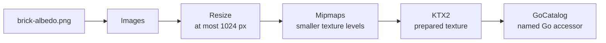

# Write an asset recipe

[Asset pipeline](README.md)

Start with one pipeline. It reads source files, applies the operations you choose
and writes a generated package your game can import.

## Prepare some textures

Put PNG or JPEG files in your game's `assets/` directory. For this example, use
an ordinary color texture such as `assets/brick-albedo.png`.

Create `asset.config.go` beside your game's `go.mod`:

```go
//go:build ignore

package main

import "github.com/karty-game/karty-webgpu/pkg/assetbuild"

func main() {
    assetbuild.Main(func(assetbuild.Environment) assetbuild.Config {
        return assetbuild.Config{
            Output: "generated/textures",
            Pipelines: []assetbuild.Pipeline{{
                Name: "textures", Input: []string{"assets/**"},
                Import: []assetbuild.Plugin{assetbuild.Images()},
                Process: []assetbuild.Plugin{
                    assetbuild.Resize(assetbuild.ResizeOptions{MaxDimension: 1024}),
                    assetbuild.Mipmaps(),
                },
                Output: []assetbuild.Plugin{
                    assetbuild.KTX2(),
                    assetbuild.GoCatalog(),
                },
            }},
        }
    })
}
```

The build tag keeps the recipe out of your game. It still runs on the host with
Go, including when the game targets the browser. Ashura's Go import path is
currently `github.com/karty-game/karty-webgpu`.



`Resize` preserves aspect ratio and won't enlarge a smaller image. `Mipmaps`
creates smaller versions for rendering at a distance. `KTX2()` writes an RGBA8
texture by default; choose its [BC1 or BC7 options](publishers/image-ktx2.md) when you
want compression. `GoCatalog` embeds the texture and gives it a Go name.

## Run it

From the Ashura repository root, run these commands with your game's directory
in place of `/path/to/game`:

```sh
mise exec -- go run ./cmd/engine assets generate --project /path/to/game
mise exec -- go run ./cmd/engine assets build --project /path/to/game --profile release
```

`generate` prepares the files you need to start developing. `build` refreshes
them for a playable build. Both prepare real assets and reuse unchanged work
from the cache. Browser build and preview commands run preparation automatically.
The [standard materials sample](../../samples/standard-materials/asset.config.go)
shows a larger recipe you can run directly.

For `assets/brick-albedo.png`, the example produces:

```text
generated/textures/
├── assets.go
└── brick-albedo.ktx2
```

Import your game's `generated/textures` package, using an alias such as
`textures`, and call `textures.BrickAlbedo()` for the prepared texture asset.
There is no PNG read at runtime. Keep source files and recipes in Git; ignore
this generated directory and the project's `generated/` build cache.

## Add another pipeline

Pipelines have their own inputs and intermediate assets. Keep dependent steps in
the same pipeline. Use another pipeline when you need a different result, such
as UI artwork alongside material textures.

`Name` identifies a pipeline; it doesn't create a directory. Set `Directory`
when two exporters would otherwise write the same filename:

```go
Output: "generated",
Pipelines: []assetbuild.Pipeline{
    {
        Name: "ui", Directory: "ui", Input: []string{"assets/ui/**"},
        Import: []assetbuild.Plugin{assetbuild.Images()},
        Output: []assetbuild.Plugin{uibuild.Images()},
    },
    {
        Name: "sprites", Directory: "sprites", Input: []string{"assets/sprites/**"},
        Import: []assetbuild.Plugin{assetbuild.Images()},
        Output: []assetbuild.Plugin{spritebuild.Images()},
    },
},
```

This is a `Config` fragment. Import `uibuild` from
`github.com/karty-game/karty-webgpu/pkg/ui/build` and `spritebuild` from
`github.com/karty-game/karty-webgpu/pkg/draw2d/build`.
The two catalogs now live in `generated/ui` and `generated/sprites`.
Neither exporter packs an atlas automatically; add [Atlas](processors/image-atlas.md)
when you want several images to share a page.

## Recipe settings

| Setting | Default | What it controls |
| --- | --- | --- |
| `Config.Output` | Required | Generated directory inside the project. |
| `Config.Pipelines` | None | The pipelines to run. |
| `Config.Profiles` | `dev`, `release` | Accepted profile names; a custom list replaces these defaults. |
| `Pipeline.Name` | Required | Unique Go identifier for the pipeline. |
| `Pipeline.Directory` | Empty | Subdirectory below `Config.Output`. |
| `Pipeline.Input` | None | Project-relative source paths or globs. `*` stays within a directory; `**` also matches subdirectories. |
| `Pipeline.Import` | None | Ordered import steps. |
| `Pipeline.Process` | None | Ordered processing steps. |
| `Pipeline.Output` | None | Ordered publishing steps. |

The callback receives an `Environment` with `Phase`, `Profile`, `TargetOS` and
`TargetArch`. Use those values to choose settings. A profile name alone doesn't
change texture size or bake quality. A numeric zero often means “use the
default”; each plugin's settings table explains where that applies.

An `Include` pattern usually selects an asset's name inside the pipeline. With
`Input: []string{"assets/**"}`, the image `assets/ui/icon.png` has the identity
`ui/icon`. Models use their project-relative `.glb` path instead. Check the
plugin's guide when selecting a subset of inputs.

A failed build leaves the last published files intact. A successful build removes
obsolete files owned by the recipe, so keep hand-authored files outside its
output directory. `--no-cache` reruns processing; `--jobs N` allows up to N
independent build actions. Zero or one keeps build execution serial.

Browse [importers](importers/README.md), [processors](processors/README.md),
[generators](generators/README.md) and
[publishers](publishers/README.md) for the next steps. The
[package reference](../../pkg/assetbuild/README.md) covers custom plugins and
advanced recipe behavior.
