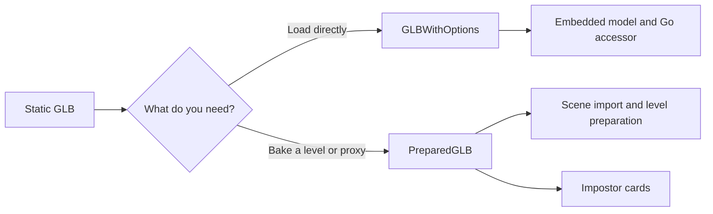

# Importers

[Asset pipeline](../README.md)

Choose the importer for your source and the output you need. Processors prepare
its data, generators derive other assets, and publishers write the result.

| I have… | Use | Result |
| --- | --- | --- |
| PNG or JPEG artwork | [Image import](image-import.md) | Images ready for resizing, atlases or texture encoding. |
| A GLB model | [Import GLB models](model-glb.md) | Embed the converted model, or pass it to level/impostor plugins. |
| YAML scenes and prefabs | [Level scenes](scene-lightmap-baking.md) | Gameplay constructors and static geometry for chunking and lighting preparation. |

The model guide covers two output choices for the same ordinary GLB input.
`GLBWithOptions` publishes an embedded catalog and can cap texture resolution;
`PreparedGLB` keeps the converted result inside the build pipeline for later
plugins and preserves authored texture resolution.

`levelbuild.Scenes` reads `.scene.yaml` and expands reusable prefabs. It generates
Go constructors for logic and dynamic objects while preparing static models for
the level pipeline. Models referenced by YAML must be imported earlier in the
same pipeline. Custom components use the shared
[scene module API](../../../pkg/scene/build/types.go).

To capture reflections from a room made of planes, boxes and spheres, use the
[reflection generator](../generators/scene-reflections.md). It reads its own
JSON format and produces a panorama and typed room data.

Next: [write a recipe](../getting-started.md), choose a
[processor](../processors/README.md), a [generator](../generators/README.md),
or a [publisher](../publishers/README.md).
