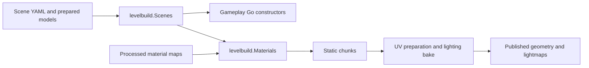

# Scenes for baked lighting

[Asset pipeline](../README.md) · [Importers](README.md)

Use `levelbuild.Scenes` to import scene/prefab YAML for a level recipe. It
generates Go constructors for logic and dynamic objects, and prepares static
geometry for chunking, UV generation and a lighting bake.

Start with `levelbuild.Scenes`, then prepare its materials with
`levelbuild.Materials`. Import
`levelbuild "github.com/karty-game/karty-webgpu/pkg/level/build"`.



The importer prepares the scene; the downstream processors calculate lighting.
Models marked `isDynamic: true` remain separate runtime models, while static
models become part of the baked chunks. Logic and dynamic lights remain live.
Lights marked `bake: static` contribute to the bake and have their generated live
intensity set to zero so the scene doesn't count their light twice.

## Settings and defaults

`levelbuild.Scenes(levelbuild.SceneOptions{...})` takes:

| Setting | Default | Meaning |
| --- | --- | --- |
| `Input []string` | None; required | Project-relative patterns selecting authored scene YAML. No matches fail the build. |
| `Modules []scenebuild.Module` | Logic and render3d modules | Components available in YAML. A non-empty list replaces the defaults. |
| `Spaces map[string]string` | No overrides | Assigns node paths to logical spaces. Descendants inherit the nearest assignment; overlapping spaces stay separate. |
| `SeparateMasked bool` | `false` | Keeps static alpha-masked parts as independent models outside the opaque bake. Set true for those parts; otherwise unsupported masked static geometry fails the build. |

Declare the YAML, referenced GLBs and separate image files in `Pipeline.Input`.
The plugin's own `Input` selects the scenes to compile. Generated scene names
come from filenames and must be distinct. Assigning a space doesn't create a
portal connection.

## Start a baked-lighting recipe

This is the beginning of a [recipe](../getting-started.md). Import `modelbuild`
as shown in [PreparedGLB](model-prepared-glb.md):

```go
assetbuild.Pipeline{
    Name: "world",
    Input: []string{"assets/**", "levels/**"},
    Import: []assetbuild.Plugin{
        modelbuild.PreparedGLB(),
        assetbuild.Images(),
        levelbuild.Scenes(levelbuild.SceneOptions{
            Input: []string{"levels/main.scene.yaml"},
            SeparateMasked: true,
        }),
    },
    Process: []assetbuild.Plugin{
        // Resize or convert separate material maps here, if needed.
        levelbuild.Materials(levelbuild.MaterialOptions{}),
        levelbuild.StaticChunks(levelbuild.ChunkOptions{}),
        // Add lightmap UV preparation and ProductionBake next.
    },
}
```

Models in the YAML use their source paths, such as `assets/building.glb`.
[Materials](../processors/level-materials.md) binds processed surface maps;
[LightmapUVs](../processors/level-lightmap-uvs.md) gives static surfaces their
lighting coordinates; [ProductionBake](../generators/level-lightmap-bake.md)
calculates the lighting. Finish with a [level publisher](../publishers/level-publish.md).

The importer writes `scenes/<Name>_gen.go` and `scenes/scene.schema.json` under
`Config.Output`. Gameplay constructors and static level data come from the same
authored scene.
The [Sponza recipe](../../../samples/sponza/asset.config.go) shows the full flow.

Custom components use the shared [scene module API](../../../pkg/scene/build/types.go).
The logic and render3d module lists are installed by default; supply a non-empty
`Modules` list when selecting a different set of components.

[Scene import implementation](../../../pkg/level/build/scenes.go)
