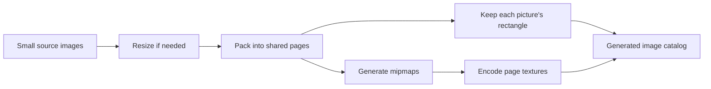

# Pack an image atlas

[Asset pipeline](../README.md) · [Processors](README.md)

Use `assetbuild.Atlas(options)` to combine many small pictures into a few shared
textures. This is useful for icons, UI artwork and sprites: each picture keeps
its own rectangle inside the shared page. The renderer uses that rectangle when
drawing it.

The packer keeps different image uses, such as color and normal maps, on separate
pages. It extends edge pixels into the space around each picture to keep
neighboring pictures from bleeding into it when sampled. Unselected images stay
separate. Repeating surface textures should also stay separate, because a region
inside an atlas cannot repeat across the entire texture.



## Settings and defaults

`assetbuild.AtlasOptions`:

| Setting | Default | Meaning |
| --- | --- | --- |
| `Name` | `"Atlas"` | Atlas group name; one valid portable path component. |
| `Include` | Empty, invalid | Required patterns matching extensionless resource identities. |
| `MaxSize` | `2048` | Maximum page dimension; power of two, at most 4096. |
| `Padding` | `1 << (MipLevels-1)` | Extruded texels around each region. Must be at least this default and at most half `MaxSize`. |
| `MipLevels` | `1` | Maximum permitted levels, including the base; range 1..13. |
| `Clamp` | `false`, invalid | Must explicitly be `true` to confirm selected artwork does not require repeating UVs. |

Zero numeric values select the defaults above. `MaxSize` is a bound, not a
request to resize artwork. Images that cannot fit with their gutters fail
preparation. Inputs must be unpacked and have only their base level.

## How to use it

For `Input: []string{"assets/**"}`, pack only `assets/ui/...`:

```go
Import: []assetbuild.Plugin{assetbuild.Images()},
Process: []assetbuild.Plugin{
    assetbuild.Resize(assetbuild.ResizeOptions{
        MaxDimension: 256, Include: []string{"ui/**"},
    }),
    assetbuild.Atlas(assetbuild.AtlasOptions{
        Name: "UI", Include: []string{"ui/**"}, Clamp: true,
        MaxSize: 1024, Padding: 4, MipLevels: 3,
    }),
    assetbuild.Mipmaps(),
},
Output: []assetbuild.Plugin{assetbuild.KTX2(), assetbuild.GoCatalog()},
```

`MipLevels` reserves enough padding for smaller texture levels;
[Mipmaps](image-mipmaps.md) actually creates those levels.
[GoCatalog](../publishers/image-catalog.md) publishes page accessors, original-image
region accessors and `atlas.json`. Use the region coordinates/UVs when drawing
an original image, rather than treating it as the whole page.

[UI Images](../publishers/ui-images.md) and [draw2d Images](../publishers/sprite-images.md) provide
runtime-specific catalogs that consume these regions. Put Atlas before those
exporters when multiple source images should share pages.

[Complete recipe](../getting-started.md) · [Source and API](../../../pkg/assetbuild/atlas.go)
