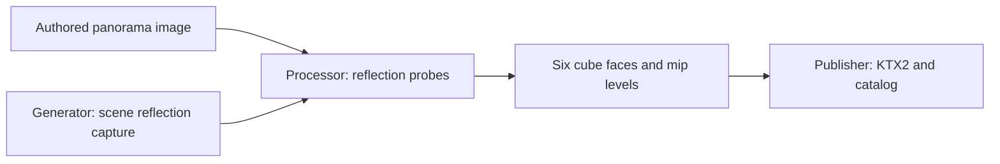

# Reflection probes

[Asset pipeline](../README.md) · [Processors](README.md)

Use `assetbuild.ReflectionProbes()` to turn a 360° panorama into an environment
reflection for shiny materials. It creates the six views of a cube around the
camera and the smaller texture levels needed when sampling them. Each face is
filtered separately so its neighbors do not bleed across the edges.

You can provide a 2:1 panorama image or generate one with the
[reflection generator](../generators/scene-reflections.md). This processor
converts panoramas already in the pipeline; it does not capture your running game.



## Settings and defaults

There are no plugin options. Resources are selected when their basename is
`reflection` or ends in `-reflection`/`_reflection`, case-insensitively.
Each selected resource must contain one base-only `UsageReflection` image with
a 2:1 width/height ratio.

Each cube face is the largest power of two no greater than
`min(panoramaHeight / 2, 512)`. A 1024×512 source therefore produces 256×256
faces. Six faces are stored horizontally in `+X, -X, +Y, -Y, +Z, -Z` order,
with a complete face mip chain. The resource name is preserved.

## How to use it

For an authored `assets/studio-reflection.png` panorama:

```go
assetbuild.Pipeline{
    Name: "environment", Input: []string{"assets/*-reflection.png"},
    Import: []assetbuild.Plugin{assetbuild.Images()},
    Process: []assetbuild.Plugin{assetbuild.ReflectionProbes()},
    Output: []assetbuild.Plugin{assetbuild.KTX2(), assetbuild.GoCatalog()},
}
```

Run this stage before KTX2. Do not run general [Mipmaps](image-mipmaps.md) or
[Atlas](image-atlas.md) on the resulting six-face atlas: its producer already owns the
face layout and mip filtering. [GoCatalog](../publishers/image-catalog.md) generates a reflection
asset accessor using `ktx2.Reflection`, which the runtime loads as a cubemap.
KTX2 defaults to RGBA8; select BC1 explicitly when the target supports it.

[Complete recipe](../getting-started.md) · [Source and API](../../../pkg/assetbuild/reflections.go) · [Reflection sample](../../../samples/reflections/README.md)
