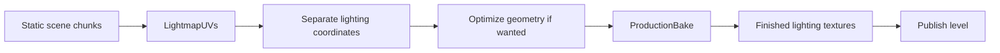

# Generate level lightmap UVs

[Asset pipeline](../README.md) · [Processors](README.md)

Use `levelbuild.LightmapUVs` to give static geometry its own non-overlapping
space in a lighting texture. A model's ordinary texture coordinates can reuse
the same pixels on many surfaces; a baked shadow needs separate pixels for each
surface. This plugin creates that second coordinate set and determines where
the baker should calculate lighting.

UVs are the 2D coordinates that map texture pixels onto a model. This plugin
uses [xatlas](https://github.com/jpcy/xatlas), embedded as WASM and run through Go.
There is no UV executable or compiler to install. See the
[processor glossary](README.md#terms-used-in-these-guides) for lighting terms.



Import `levelbuild` from `github.com/karty-game/ashura/pkg/level/build`.
Place it in `Pipeline.Process` after [StaticChunks](level-static-chunks.md). Use
`Production: true` for the current production compute lightmapper. Alternatively,
pass `UVOptions` through `ProductionBake.UVs` and omit this separate plugin.

## Settings and defaults

`LightmapUVs(levelbuild.UVOptions{...})` takes:

| Setting | Default | Meaning |
| --- | --- | --- |
| `Production bool` | `false` | Prepares the individual lighting samples needed by `ProductionBake`. Set `true` for a separate UV stage; integrated `ProductionBake.UVs` selects it automatically. |
| `TexelsPerUnit float32` | `16` | Physical lightmap density. Zero selects the default. |
| `MaxPageSize uint32` | `1024` | Preparation page cap; power of two from 16 to 1024. Zero selects 1024. Final publication atlas size is a separate setting. |
| `Padding uint32` | `4` | Chart gutter width in texels; zero selects 4. |
| `TransportSamples uint32` | `64` | Samples for the non-production precomputed transport path; zero selects 64. Production receiver preparation does not use this setting. |
| `PreserveGeometricNormals bool` | `false` | Keeps exact surface directions for tracing in the non-production path, instead of precomputed coarse bounce data. The production path directly prepares the needed surface geometry. |

The zero value is a general UV configuration, not a production-bake preset.
Neither zero padding nor zero density disables the corresponding work.

## How to use it

```go
// Optional meshbuild.Cleanup() belongs after PreparedGLB and before Scenes.
levelbuild.StaticChunks(levelbuild.ChunkOptions{}),
levelbuild.LightmapUVs(levelbuild.UVOptions{
    Production: true,
    TexelsPerUnit: 8,
    MaxPageSize: 512,
    Padding: 4,
    PreserveGeometricNormals: true,
}),
meshbuild.Optimize(), // Optional; updates geometry and matching lighting data together.
// ProductionBake with UVs left nil follows here.
```

Start with density and page size appropriate to the scene scale; raising density
increases receiver count, bake work and delivered texture memory. Geometry work
is explicit: [Cleanup](mesh-cleanup.md) precedes scene import and UV generation;
[Optimize](mesh-optimize.md) follows UV generation and precedes baking. The level
pipeline keeps the lighting data matched to the final mesh. Import `meshbuild`
from `github.com/karty-game/ashura/pkg/mesh/build` for these optional stages.

[Plugin source](../../../pkg/level/build/uv.go) · [Pipeline guide](../getting-started.md)

