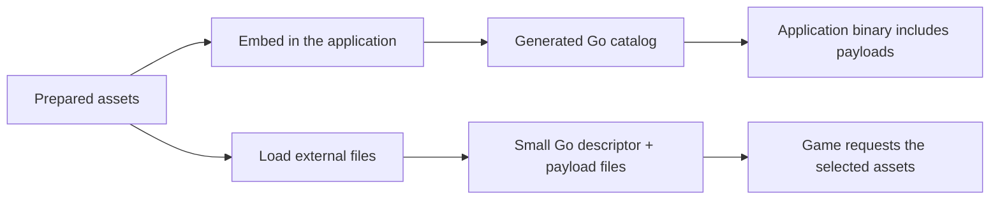

# Publishers

[Asset pipeline](../README.md) · Publishers

Publishers write the files your game will use: textures, model data, image
catalogs and baked levels. Put them in `Pipeline.Output`, after the importers,
processors and generators that prepare their inputs.

First choose how the game should receive those assets. Embedded catalogs are
convenient for assets the game always needs. External files keep payloads out of
the application binary and let the game load a model or level when needed.
Both count toward the size of the complete game download.

| What you need | Publisher | What it writes |
| --- | --- | --- |
| Texture files | [KTX2](image-ktx2.md) | `.ktx2` files, with explicit RGBA8, BC1 or BC7 storage. |
| Embedded textures | [GoCatalog](image-catalog.md), after KTX2 | Named texture accessors and embedded KTX2 payloads. |
| UI artwork | [UI images](ui-images.md) | Embedded RGBA8 pages and a UI image catalog. |
| Sprites | [2D images](sprite-images.md) | Embedded RGBA8 or BC pages and a sprite image catalog. |
| One baked level profile | [Publish](level-publish.md) | External level files and a matching descriptor. |
| Chosen level profiles | [PublishVariants](level-publish-variants.md) | Two or more profiles sharing the same bake. |

The [GLB importer](../importers/model-glb.md) publishes its own embedded model
catalog. Level publishers write static geometry and independent dynamic models
as part of the level's external delivery tree.

The [default-font generator](../generators/font-default.md) writes its own atlas
and metrics; ordinary UI applications can use the existing bundled font.
For UI and sprite images, choose their dedicated publisher rather than combining
KTX2 and GoCatalog. Those catalogs provide the image handles their renderers
expect.

Publishing does not automatically make an asset smaller. `KTX2()` and the image
publishers default to RGBA8. Select compression when appropriate for your
devices, resize large textures with [Resize](../processors/image-resize.md), and only
publish the level profiles your game needs. See [tools and formats](../tools.md)
for the libraries involved in preparation.
