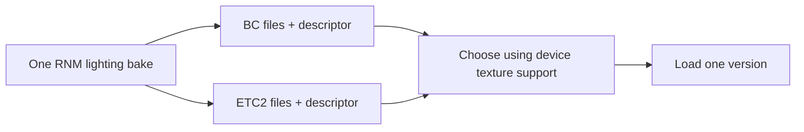

# Publish level variants

[Asset pipeline](../README.md) · [Publishers](README.md)

`levelbuild.PublishVariants` prepares several versions of one baked level. For
example, ship RNM lighting with BC textures for desktop GPUs and ETC2 textures
for mobile GPUs. The expensive lighting bake is shared; each version receives
the files and descriptor it needs.

Import `levelbuild` from `github.com/karty-game/ashura/pkg/level/build`.
Place this plugin in `Pipeline.Output` after
[ProductionBake](../generators/level-lightmap-bake.md).

## Settings and defaults

`PublishVariants(profiles ...levelbuild.PublishOptions)` requires at least two
profiles. Every profile needs a distinct nonempty `Variant` that is a valid Go
identifier. All other options and defaults are those of [Publish](level-publish.md).
No profiles are implicitly added. Use `Publish` for a single profile.

A requested representation must be available from the bake. RNM-only
publication needs only RNM output. Declare every profile explicitly; a profile
name does not add RGB maps or other texture families.



## How to use it

Publish only RNM, prepared for desktop BC and mobile ETC2:

```go
quality := 0
profile := func(name, family string) levelbuild.PublishOptions {
    return levelbuild.PublishOptions{
        Variant: name,
        BundleChunks: true,
        Representation: "rnm-fit-v1",
        NativeTextures: &levelbuild.NativeTextureOptions{
            Family: family, NativeAlbedo: true, ProfileMaterials: true,
            Encoder: assetbuild.BlockCompressionOptions{
                LDRQuality: &quality, SSBumpQuality: &quality,
            },
        },
        AlbedoETC1S: &levelbuild.ETC1SOptions{Quality: 192},
    }
}
// In the pipeline declaration:
// Output: []assetbuild.Plugin{publication},
publication := levelbuild.PublishVariants(
    profile("RNMBC", "bc"),
    profile("RNMMobile", "etc2"),
)
```

The explicit effort-zero choices reduce offline encoder work; they are not the
same defaults as a raw `PublishOptions` encoder with nil `SSBumpQuality`.
Applications choose a supported descriptor after initializing the device. They
load only the selected profile's dependencies. Publication still counts every
exported profile toward the complete distribution size.

`BundleChunks: true` groups each chunk's geometry, UVs and lightmaps into one
uncompressed file per profile. `ProfileMaterials: true` places native albedo
and relief under the selected `texture-profiles/bc/levels/textures/` or
`texture-profiles/mobile/levels/textures/` directory. This option requires
`NativeAlbedo`. Chunks in the same profile can share material textures.
See [chunk publication](level-publish.md#load-a-chunk-as-one-unit) for the layout
and loading costs.

[Complete Sponza recipe](../../../samples/sponza/asset.config.go) ·
[Plugin source](../../../pkg/level/build/publish_variants.go) · [Pipeline guide](../getting-started.md)
