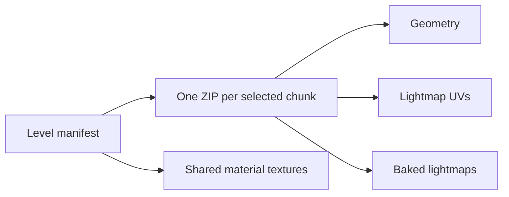

# Publish a baked level

[Asset pipeline](../README.md) · [Publishers](README.md)

`levelbuild.Publish` writes the geometry, UVs and textures needed to load one
baked level profile. It packs the baked charts into final atlases and writes
external files plus a small Go descriptor. The game loads those prepared files
without needing the original source models.

Import `levelbuild` from `github.com/karty-game/ashura/pkg/level/build`.
Place this plugin in `Pipeline.Output`, after
[ProductionBake](../generators/level-lightmap-bake.md). Use
[PublishVariants](level-publish-variants.md) when you need several texture formats or
lighting representations from the same bake.

## Settings and defaults

`Publish(levelbuild.PublishOptions{...})` takes:

| Setting | Default | Meaning |
| --- | --- | --- |
| `Variant string` | Empty | Optional Go identifier distinguishing this descriptor from other profiles. |
| `Representation string` | Empty, preserves baked page representation | `"rgb-diffuse-v1"` selects one RGB map; `"rnm-fit-v1"` selects three RNM maps. The requested result must exist in the bake. |
| `Package string` | `"levels"` | Generated descriptor package; must be a valid non-keyword Go identifier. |
| `Development bool` | `false` | Also publishes per-page `.klightmap` bake inputs and retains individual development pages. Runtime loaders do not fetch these inputs. |
| `MaxAtlasSize uint32` | `1024` | Final chart-consolidation cap; accepts 1024 or 2048. Independent of the UV preparation page cap. |
| `BundleChunks bool` | `false` | Publish each chunk's geometry, lightmap UVs and baked lightmaps in one stored ZIP. Material textures stay separate and shared. |
| `NativeTextures *NativeTextureOptions` | `nil` | Opt into normalized LDR GPU-native delivery, described below. |
| `NativeHDR *NativeHDROptions` | `nil` | Alternative HDR/RGBE native delivery profile. Mutually exclusive with `NativeTextures`. |
| `AlbedoETC1S *ETC1SOptions` | `nil` | Optional ETC1S albedo preparation. Set `Quality` explicitly from 1 to 255; zero is invalid. |

Without native texture options, lightmaps retain their baked numeric encoding.
`AlbedoETC1S` alone selects a browser load-time transcoding profile. To ship
GPU-ready compressed albedos to both browser and native loaders, combine it with
`NativeTextures.NativeAlbedo: true`, as below. Encoding runs offline through
embedded WASM libraries.

For a typical desktop RNM level, start with the example below. For desktop and
mobile together, use the two-profile [PublishVariants](level-publish-variants.md)
example. Compression is prepared with [Basis Universal](https://github.com/BinomialLLC/basis_universal)
during the build.

### Normalized LDR delivery

| `NativeTextureOptions` field | Default | Meaning |
| --- | --- | --- |
| `Family` | `"bc"` | Desktop `"bc"` or mobile `"etc2"`. |
| `LightmapFormat` | `"bc7"` for BC, `"etc2"` for ETC2 | BC also permits `"bc1"` for 4 bits per pixel. Format must match family. |
| `Transfer` | `"srgb"` | `"srgb"` or `"linear"` stored RGB transfer. Both retain the shared RGB/RNM tuple scale. |
| `NativeAlbedo` | `false` | Offline opaque albedo block preparation; requires non-nil `AlbedoETC1S`. |
| `Encoder.LDRQuality` | Nil selects effort `0` | Pointer to UASTC effort 0–4 for lightmaps/albedos. |
| `Encoder.SSBumpQuality` | Nil selects effort `4` | Pointer to UASTC effort 0–4 for desktop SSBump. Mobile SSBump keeps exact linear RGBA8 channels and authored mips. |
| `Encoder.Timeout` | Zero selects `2m` | Per-texture complete offline operation timeout. Negative values fail. |

`Encoder.RGBEQuality` and `HDREffort` have no role in normalized LDR delivery.
Native BC lightmaps/albedos need BC device support; mobile uses ETC2. Select the
matching descriptor after device initialization rather than choosing by platform
name alone.

### HDR delivery

`NativeHDROptions.Family` defaults to `"bc"` (BC6H RNM and BC7 SSBump).
`"etc2-astc"` selects RGBE ETC2 RNM and linear ASTC SSBump, requiring those device
formats. `NativeAlbedo` defaults to false and uses the same explicit ETC1S
preparation requirement when enabled. Its `Encoder` takes `HDREffort` 0–4
(default 0), `SSBumpQuality` pointer 0–4 (nil selects 4), `RGBEQuality` pointer
0–4 (nil selects 3), and `Timeout` (zero selects 2 minutes).

## Load a chunk as one unit

Set `BundleChunks: true` to download a chunk's geometry, lighting coordinates
and lightmaps together. Packing happens during publication, after geometry and
texture preparation. The ZIP uses stored entries, so loading does no ZIP
decompression or asset conversion.
Bundled output requires the calibrated RGB diffuse or RNM page representation
used by `ProductionBake`.



Material textures remain separate files. Neighboring chunks can reuse their
existing downloads and GPU residency without including the same textures in
every pack. Independent models and optional developer bake inputs also keep
their own files. Texture atlasing and streaming policy are separate choices.

The build writes entry offsets into the level manifest. The loader reads one
pack, verifies its bounds and checksums, and uses views into the prepared bytes.
It retains the existing stepped GPU uploads. The pack buffer can remain alive
until its chunk resources are released. A pack is limited to 128 MiB; the
complete chunk read remains bounded to 256 MiB. The loader rejects an invalid
pack instead of retrying its entries as loose files.

For `PublishVariants`, set the option on each profile that should use packs.
Each GPU profile has its own packs; only the selected profile is downloaded.

## How to use it

A single compressed desktop RNM profile:

```go
Output: []assetbuild.Plugin{
    levelbuild.Publish(levelbuild.PublishOptions{
        Variant: "RNMBC",
        Representation: "rnm-fit-v1",
        MaxAtlasSize: 1024,
        BundleChunks: true,
        NativeTextures: &levelbuild.NativeTextureOptions{
            Family: "bc", NativeAlbedo: true,
        },
        AlbedoETC1S: &levelbuild.ETC1SOptions{Quality: 192},
    }),
},
```

The configured generated output contains `public/levels/` resources and a
`levels/` descriptor package, alongside generated scene factories under
`scenes/`. Use the descriptor with the public
[level runtime](../../../pkg/level/README.md); let the normal web build copy the
public delivery tree.

[Plugin source](../../../pkg/level/build/publish.go) · [Pipeline guide](../getting-started.md)
